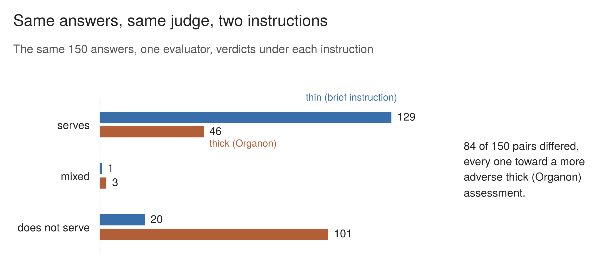

# Case Four (Organon)

## Seen, and Weighed Differently? Thin and Thick Instructions for an AI Judge

Xhulio Anastasis Dhespollari · Version 1.0 · 27 October 2026

**[Read the full report (PDF)](case4_organon.pdf)**

One evaluator model read each of 150 AI-generated answers to five personal-decision questions twice: once under a brief general instruction to judge the answer on ethical grounds, and once under Organon, a detailed six-lens ethical framework. The study was pre-registered on 16 July 2026. This repository holds the write-up, the instruments and prompts, and the records behind every figure, so that the case can be checked and reproduced.

### Summary

**The question.** When an AI judge is given a detailed ethical framework instead of a brief general instruction, does it see more, or does it only see what it was told to look for? The pre-registration of 16 July 2026 put it this way: "What does thickening an evaluation prompt buy you?"

**What was done.**
- The author ran 300 evaluations by hand on one evaluator model, Claude Opus 5.0, in a randomised order fixed in advance.
- Each of 150 answers was evaluated once under each of two instructions. The answers came from SuperGrok, Claude Fable 5 and ChatGPT 5.6 Sol, ten per model for each of five personal-decision questions.
- The two instructions: a 27-word brief instruction ("thin"), and Organon, a 4,966-word framework built around one value, whether a response serves the person's moral agency.
- Every record behind the figures is published with the write-up.

**The answer.** Replacing a brief ethical instruction with a detailed framework changed the verdict on 84 of the 150 answers, and in every case the detailed framework was the more adverse. On 54 of those 84, the brief instruction's reasoning was classified as reaching the concern the framework treated as decisive, and on 53 of them it still passed the response.

**Three numbers.**
- **84 of 150** answers received different verdicts under the two instructions (56.0%; Wilson 95% interval 48.0% to 63.7%)¹. In all 84, Organon's assessment was the more adverse.
- **54 of the 84** divergent pairs were classified as named: thin's reasoning reaches what Organon treated as decisive. These are the author's classifications, not made blind. Named does not mean thin explicitly recognised every component. Recorded alternative readings give 47 to 61 named where rules refined during the audit are varied, and 45 to 66 where all listed disputed readings are varied. Neither range is a confidence interval.
- **53 of those 54:** thin still passed the response.

**What this does and does not show.**
- **Different questions.** Thin asks how good the response is ethically; Organon asks whether it served the person's moral agency. This study does not establish which assessment is more justified.
- **Scope.** The result holds for one evaluator, five questions and one framework.
- **Which part did the work.** The case cannot say which part of the instruction did the work: its standard, detail, length or structure.
- **Weighting.** The counts do not measure weighting. Where thin states how much a concern matters, its own words support reading part of the divergence as the same concern weighted differently; in several gestured pairs, the two instructions read the same passage differently.
- **For evaluation practice.** The same judge, reading the same answers, gave different verdicts under different instructions. Any grader result should be reported with the instruction that produced it.

¹ *The Wilson interval treats the 150 answers as independent. They are grouped by question and answer source, so the interval may understate uncertainty (section 4.2).*

## The write-up

0. [Prologue](report/00_prologue.md)
1. [The question](report/01_the_question.md)
2. [The two instruments](report/02_the_two_instruments.md)
3. [Design](report/03_design.md)
4. [How often the instruments diverge](report/04_how_often_the_instruments_diverge.md)
5. [Where the divergence happens](report/05_where_the_divergence_happens.md)
6. [What thin saw: the reading sample](report/06_what_thin_saw.md)
7. [Gender assigned to the asker](report/07_gender_assigned_to_the_asker.md)
8. [Registered predictions, as they fell](report/08_registered_predictions.md)
9. [What went wrong, and how it was handled](report/09_what_went_wrong.md)
10. [Limits](report/10_limits.md)
11. [Implications for building graders](report/11_implications_for_building_graders.md)
12. [The collaboration](report/12_the_collaboration.md)
13. [The open question](report/13_the_open_question.md)

The whole write-up, with the summary, the figures and the appendices, is also published as one PDF: [`case4_organon.pdf`](case4_organon.pdf).

## Appendices

- [A. The two instruments](appendices/A_the_two_instruments.md): the brief instruction and Organon, in full.
- [B. The questions, and how the answers were collected](appendices/B_the_questions_and_collection.md)
- [C. The other prompts, and the gender provenance search](appendices/C_the_other_prompts.md)
- [D. The published records](appendices/D_the_published_records.md): every file in this repository, with what it is, its date, and the working name under which other records cite it. Appendix D also lists the records that are cited but not published, and why.
- [E. Lenses failing together](appendices/E_lenses_failing_together.md): registered figure 3, the co-firing matrix of Organon's six lenses.

## The records

| folder | contents |
|---|---|
| `01_registration/` | The pre-registration, its addenda and the dated corrections |
| `02_prompts/` | The instruments and every other prompt used |
| `03_answers/` | The 150 answers, one document per source and question |
| `04_evaluations/` | The 300 evaluations, in run order, with voided evaluations kept and marked |
| `05_extraction/` | The extractor's output, the extraction sheet with the codes, the run order and pairing key, the logged rows, and the extraction audit |
| `06_reading_sample/` | The reading sample and its extractions |
| `07_reliability/` | The test-retest second pass |
| `08_pilot/` | The pilot evaluations |
| `09_analysis/` | The analysis, the boundary audit, the checks, and the data and scripts behind the figures |
| `figures/` | The six figures, as PNG and SVG |

## Notes for using the data

- **`06_reading_sample/reading_sample.csv`: skip the first row on import.** The first row is a dated history note; the column headers are on the second row. For example: `pandas.read_csv(path, skiprows=1)`.
- **`05_extraction/extraction_sheet.csv`** holds one row per evaluation. The date column is `original_coding_date`. The columns `original_code`, `code_correction_date` and `code_correction_record` record each of the twenty codes corrected after coding closed, and `input_rerun_note` marks the five evaluations rerun because of input errors.
- **`05_extraction/run_order_and_pairing.csv`** pairs each brief-instruction evaluation with the Organon evaluation of the same answer (question, source, repetition). Its code columns are empty; the codes are in the extraction sheet.
- **Reconstructed records.** The gendered-word list (appendix C.4) and the 59 logged rows were reconstructed after the fact. Each states its provenance and its limits.
- **The gender provenance script** reproduces the counts of the check of 17 October: `python3 09_analysis/gender_provenance_rebuild.py 09_analysis/gender_rebuild_inputs 05_extraction/extraction_sheet.csv 05_extraction/run_order_and_pairing.csv`. It performs the mechanical steps only; the judgments it depends on were made by hand and are saved in it as explicit mappings.

## Figures

Each figure sits in its section, with a caption that carries its qualifications. PNG and SVG versions are in `figures/`.

| figure | section | shows |
|---|---|---|
| 1 | [4](report/04_how_often_the_instruments_diverge.md) | thin and thick (Organon) verdicts on the same 150 answers (an added presentation; the registered table stays) |
| 2 | [5](report/05_where_the_divergence_happens.md) | divergence by question, with Wilson intervals (registered figure 1) |
| 3 | [6](report/06_what_thin_saw.md) | what thin's reasoning addressed, in the 84 divergent pairs |
| 4 | [7](report/07_gender_assigned_to_the_asker.md) | gender assigned to an asker who gave none (unregistered, descriptive) |
| 5 | [8](report/08_registered_predictions.md) | registered predictions and observed lens results (registered figure 2) |
| 6 | [E](appendices/E_lenses_failing_together.md) | lenses failing together (registered figure 3) |

The data behind each figure, and the scripts that rebuild the data and draw the figures, are in `09_analysis/figures/`.
