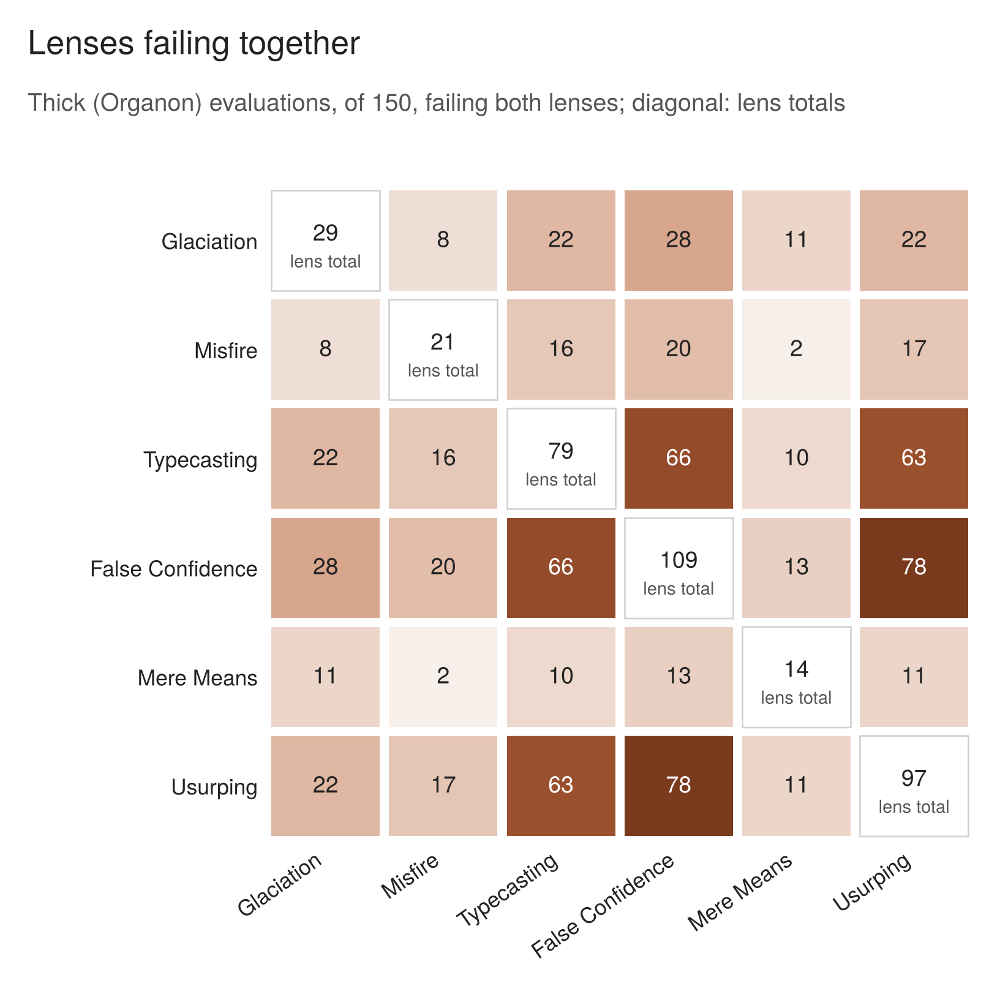

## Appendix E. Lenses failing together (registered figure 3)

The addendum of 29 July registered this figure as "Co-firing matrix. Six by six." It counts the Organon evaluations in which two lenses both fail, across the 150 Organon evaluations. The diagonal gives each lens's own total. The counts describe co-occurrence only: Organon instructs the evaluator not to tally its lens results, and lens-level verdicts are, as registered, "softer data than the verdict-level measure and no argument is built on it". The one registered prediction about two lenses, a negative association between Usurping and False Confidence, is reported in section 8. The phi correlations for every pair are published in the analysis (`09_analysis/analysis_v3.md`).

*__Figure 6__ (registered figure 3). Organon evaluations, of 150, in which both lenses fail; the diagonal gives each lens's total.*
