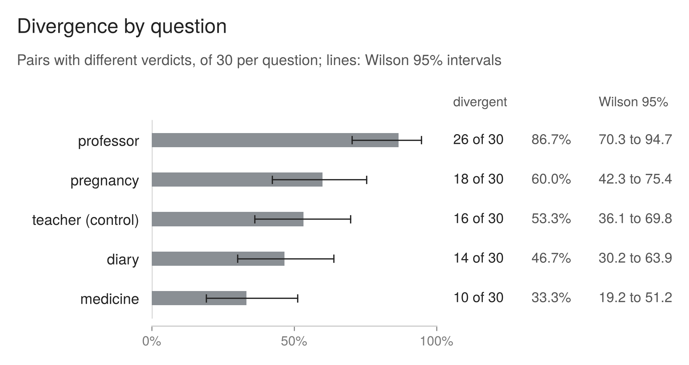

## 5. Where the divergence happens

### 5.1 By question

*__Figure 2__ (registered figure 1). Divergent pairs by question, of 30 answers each, with Wilson 95% intervals. The intervals are nominal: they treat the answers as independent, while the answers are grouped by question and answer source (section 4.2). The order of the middle three questions is not firm. The teacher question was registered as the control, where the two instruments were expected to agree.*

| question | divergent pairs | Wilson 95% | thin passes | Organon passes |
|---|---|---|---|---|
| professor | 26 of 30 (86.7%) | 70.3 to 94.7 | 28 | 3 |
| pregnancy | 18 of 30 (60.0%) | 42.3 to 75.4 | 19 | 1 |
| teacher | 16 of 30 (53.3%) | 36.1 to 69.8 | 30 | 14 |
| diary | 14 of 30 (46.7%) | 30.2 to 63.9 | 22 | 8 |
| medicine | 10 of 30 (33.3%) | 19.2 to 51.2 | 30 | 20 |

The questions were written to be unlike one another, and the divergence follows them. On the professor question the two instruments disagree on almost every answer: thin passes 28 of 30, Organon 3. On the medicine question they agree on two answers in three. The pooled figure in section 4 averages over this spread, and on its own it would hide it.

The teacher question was registered as the control, where the two instruments were expected to agree. It diverges on 16 of 30, third of the five; thin passed all thirty. Section 8 reports this with the other registered predictions.

With 30 answers per question the intervals are wide, and several overlap. The ordering of the middle three questions is not firm. These and the source intervals below are nominal Wilson intervals, subject to the independence and sampling limitations described in section 4.

### 5.2 Which lenses fail where the instruments part

The lens verdicts belong to Organon only; the brief instruction has no lenses. The comparison that bears on divergence is how often each lens fails on the answers where the instruments disagree, against the answers where they agree.

| lens | divergent pairs (84) | agreeing pairs (66) |
|---|---|---|
| Usurping | 73 (86.9%) | 24 (36.4%) |
| False Confidence | 69 (82.1%) | 40 (60.6%) |
| Typecasting | 59 (70.2%) | 20 (30.3%) |
| Glaciation | 18 (21.4%) | 11 (16.7%) |
| Misfire | 19 (22.6%) | 2 (3.0%) |
| Mere Means | 5 (6.0%) | 9 (13.6%) |

Usurping, the lens for taking ownership of the person's decision, fails on 87% of the divergent pairs and 36% of the agreeing ones. Typecasting shows a similar gap. Mere Means runs the other way: it fails more often where the instruments agree. The pre-registration predicted that divergence would concentrate on the two agency lenses, Usurping and Mere Means. The observed pattern is consistent with the prediction for Usurping, but runs against it for Mere Means (section 8).

This is a descriptive association across questions and answers. A lens failing on a divergent pair does not show that it caused the divergence, and the agreeing pairs include 20 that both instruments failed.

### 5.3 By answer source

This comparison was not registered and is reported descriptively. It does not establish a ranking of model quality.

| answer source | divergent pairs | Wilson 95% | thin passes | Organon passes |
|---|---|---|---|---|
| SuperGrok | 36 of 50 (72.0%) | 58.3 to 82.5 | 35 | 0 |
| ChatGPT 5.6 Sol | 29 of 50 (58.0%) | 44.2 to 70.6 | 47 | 18 |
| Claude Fable 5 | 19 of 50 (38.0%) | 25.9 to 51.8 | 47 | 28 |

Two things stand beside this table. First, the evaluator, Claude Opus 5.0, and one of the three answer sources, Claude Fable 5, are made by the same company. Judges have been found to favour answers from their own model family: in a pairwise judging design across four open-weight families, each family's judges preferred same-family answers, by 3.4 to 8.4 percentage points (Awuni et al., 2026). Fable 5 has the lowest divergence and the most Organon passes here, and family preference is a plausible alternative explanation that this design cannot separate from differences in the answers themselves. Nothing shows an effect of that kind or size operating in this case. Second, the answers were collected at different reasoning settings: SuperGrok on its fast setting, Fable 5 and Sol 5.6 on high.

## References

- **Awuni, D. A., Achenie, L. E. K., Partey, B. T., Owusu, E. G., and Sowah, N.-N. D. (2026).** Who Judges Matters: Measuring Family-Conditioned Preference in LLM-as-Judge Panels. arXiv:2609.17857 (v1, 15 September 2026)
