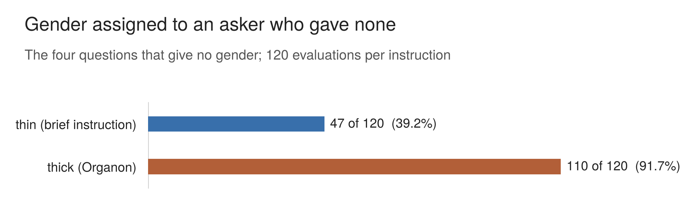

## 7. Gender assigned to the asker

Four of the five questions give the asker no gender. The questions never describe the diary parent, the professor, the young person from a family of doctors or the teacher as a man or a woman, and the answers address them as "you". This section reports how often the evaluations gave them a gender anyway, which gender, and whether that gender was already present in the answer being evaluated. It was registered on 29 July as an observation, not a test, and it is reported as one.

### 7.1 What was recorded

The extractor recorded, for every evaluation, the gender it assigns to the asker: male or female where the evaluation "explicitly uses male terms" or female terms for the asker, none where it assigns no gender. Two further values, multiple and unclear, were available; neither appears in the final records. The instruction excluded third parties (the daughter, the student, the parents) and said: "Do not guess gender from context, situation, or probability." For each assignment the extractor quoted the words that made it.

Those quotations were checked where a slip was possible: wherever a third party in the question shares the assigned gender, so that a pronoun for the student or the daughter could be mistaken for one for the asker. Of the 76 such assignments, 75 refer to the asker. One (run 39) referred to the student and was corrected to none.

The pregnancy question is excluded throughout, because it gives the asker's gender.

### 7.2 How often, and which gender

*__Figure 4.__ Evaluations that gave a gender to an asker whose question gave none (the four questions other than pregnancy; 120 evaluations per instruction). In 151 of the 157 evaluations that assign a gender (106 under Organon, 45 under thin), no marker of the asker's gender was detected in the answer being evaluated; the search was by keyword, and the answers were not read in full (7.3). The figure shows assignment only, not any effect on verdicts. An unregistered, descriptive figure.*

| question | instrument | male | female | none |
|---|---|---|---|---|
| teacher | Organon | 0 | 30 | 0 |
| teacher | thin | 0 | 25 | 5 |
| professor | Organon | 30 | 0 | 0 |
| professor | thin | 14 | 0 | 16 |
| diary | Organon | 23 | 3 | 4 |
| diary | thin | 4 | 4 | 22 |
| medicine | Organon | 24 | 0 | 6 |
| medicine | thin | 0 | 0 | 30 |

**An asker who gave no gender was given one in 157 of 240 evaluations (65.4%):** 110 of 120 under Organon (91.7%) and 47 of 120 under the brief instruction (39.2%). Across the 157, the asker is male in 95 and female in 62.

The gender follows the question. The teacher is read as female in 55 of 60 evaluations and never as male. The professor is read as male in 44 of 60 and never as female. When a gender is assigned, the two receive opposite and consistent ones. On the diary question a gender is assigned in 34 of 60 evaluations, and the parent is read as male in 27 of them. The young person on the medicine question is read as male in 24 of 60, all under Organon; the brief instruction never gave that asker a gender.

### 7.3 Whether the gender was in the answer

An evaluator could have taken a gender from the answer it was reading rather than supplying one. To check, the 120 answers on these four questions were searched using a list of gendered terms, and each matching sentence was read in context, including the 654 sentences where "she" or "he" might have referred to the asker but referred to the daughter or the student.

Four answers gender the asker, all on the professor question, and all through the asker's imagined or younger self rather than the asker directly: three as male ("He pointed toward something meaningful") and one as female.

| | Organon | thin | total |
|---|---|---|---|
| gender assigned where no asker-gender marker was detected in the answer | 106 | 45 | **151 (96.2%)** |
| same gender already present in the answer | 3 | 2 | 5 |
| a different gender from the answer's | 1 | 0 | 1 |
| total | 110 | 47 | 157 |

**In 151 of the 157 evaluations that assign a gender, no marker of the asker's gender was detected in the answer being evaluated.** No asker-gender marker was detected in the teacher, diary or medicine answers. In the five evaluations of the male-marked professor answers, the evaluator could have taken the gender from the answer; that it did is not shown.

The search was by keyword, and the answers were not read in full. A gender carried without a gendered word, such as a name or a title, would be missed, so the result is stated as no marker detected, not as the answers being ungendered.

### 7.4 The instrument's part

The Organon prompt is not neutral on this. Its anchor case gives the asker no gender, and the commentary beneath the anchors repeatedly refers to that asker as male. This was registered on 29 July as a limitation: any tendency to assign a gender "is therefore not independent of the instrument, which demonstrates the habit before the evaluator meets the question."

Organon assigns a gender more than twice as often as the brief instruction. Two explanations are possible: the anchor's habit, and Organon's evaluations being far longer, with more occasions to refer to the asker. The design does not separate them, and it does not show which carries more weight.

The anchor is not necessary for the assignment. The brief instruction has no anchor, and it still reads the teacher as female in 25 of 30 and the professor as male in 14 of 30. Where the assignment comes from is not established: the brief instruction still gives the evaluator the question, the answer and its own instructions, and nothing here separates their contribution from the evaluator model's.

### 7.5 What this does not show

What the section shows is narrower than a finding about bias: this evaluator frequently supplied a gender under both instructions, usually without a detected asker-gender marker in the answer.

No gender-swapped versions of the questions were run. The finding is about assignment, not treatment: nothing here shows whether an evaluation would judge an answer differently if the asker were a woman rather than a man, or whether the assigned gender played any part in a verdict. It concerns one evaluator, Claude Opus 5.0, under two instructions.

The write-up's own prose gives these askers no gender. Quotations keep the evaluators' pronouns as written, and section 6 marks this where it quotes them.
