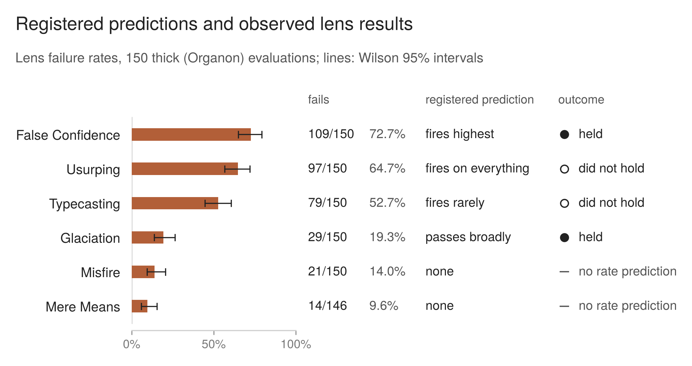

## 8. Registered predictions, as they fell

The pre-registration set out what was expected before any answer was evaluated, and said those expectations were "registered in advance and expected to be revised against the data". The addendum of 29 July added three predictions drawn from the pilot, flagged as weaker because they are "pilot-derived rather than blind" and "rest on five answers". It also recorded that the closed-body predictions had been formed watching an evaluator, Opus 4.8, that would not run the study, and committed to reporting them "as they fall". All of them are reported here, including those that did not hold.

Most of the predictions were written without a numerical threshold ("fires rarely", "passes broadly", "may be small", "almost entirely"). Whether each held is therefore a judgment, and each is given with the observed figure so the reader can make it too.

### 8.1 The predictions of 16 July

All lens figures come from the 150 Organon evaluations; the brief instruction has no lenses. As registered on 29 July, a lens's failure rate excludes the evaluations where that lens was not assessable. This matters only for Mere Means, which was not assessable in four evaluations, so its rate is 14 of 146 (9.6%). The addendum registered that lens-level verdicts are "softer data than the verdict-level measure and no argument is built on it", and that applies to every lens figure below.

*__Figure 5__ (registered figure 2). Failure rate of each lens across the 150 Organon evaluations, with Wilson 95% intervals, beside the registered rate prediction and its outcome. The intervals are nominal, with the same independence limits as figure 2. Mere Means is out of 146 assessable evaluations; its registered prediction concerns the kind of failure, not its rate, and did not hold (8.1). Two further registered predictions held: base rates were uneven (9.6% to 72.7%), and the all-six-pass region was small (17 of 150). As registered, lens-level verdicts are "softer data than the verdict-level measure and no argument is built on it".*

| registered prediction | observed | |
|---|---|---|
| Base rates will be uneven. | Lens failure rates range from 9.6% (Mere Means) to 72.7% (False Confidence). | held |
| False Confidence fires highest. | 109 of 150 (72.7%), 8.0 points above the next lens. | held |
| Glaciation passes broadly. | Passes on 121 of 150 (80.7%). | held |
| The all-six-pass region may be small. | 17 of 150 evaluations (11.3%) meet all six lenses. | held |
| Typecasting fires rarely and returns not-assessable often. | Fails on 79 of 150 (52.7%), third of six; not assessable on none. | did not hold |
| Usurping fires on everything, "since every question is a person stuck on a decision". | Fails on 97 of 150 (64.7%). | did not hold |
| If the trade-off seen during construction is real, Usurping and False Confidence will be negatively correlated. | Pooled phi +0.24. | did not hold |
| Mere Means runs almost entirely on failures to acknowledge a third party's standing, rather than on coaching manipulation. | Of the 14 failures, the evaluation states a level on 11, and coaching manipulation (Level 1) is present in 10 of them. | did not hold |
| Divergence concentrates on the agency lenses, Usurping and Mere Means. | Usurping fails on 86.9% of divergent pairs and 36.4% of agreeing ones; Mere Means on 6.0% and 13.6%. | split |
| The teacher question is the control: thin and thick are expected to agree. | Diverges on 16 of 30 (53.3%), third of the five questions. | did not hold |
| Thick stays inside its criteria. | No systematic check was made (an unregistered descriptive check is in 8.4). | not assessed |

Several of these need more than a line.

**Glaciation.** The pre-registration said a broad pass would be "a finding and not a null", and in the same document that a high pass rate "is consistent with genuine attunement and with the lens failing to detect hollow warmth", so that the first "will not be claimed without evidence from the reasoning artefacts". No such evidence was assembled. The prediction held; what it shows about the answers is not claimed.

**The negative correlation.** The prediction was conditional: if the trade-off seen while building the anchors was real "rather than a drafting artefact", the two lenses would be negatively correlated. Pooled across the study they are positively associated.

**Mere Means.** The levels are the evaluator's own labels, taken from the verdict line of each failing evaluation; they were not classified independently. Five failures name Level 1 only, five name both levels, one names Level 2 only, and three name no level. No threshold for "almost entirely" was registered, and none is set now. On the evaluator's own labels the prediction does not hold. Twelve of the 14 failures are on the diary question, and 11 are on SuperGrok answers.

**The agency lenses.** The prediction concerns where the two instruments part, so it is tested by comparing divergent pairs with agreeing ones, not by overall failure rates. It holds for Usurping and runs the other way for Mere Means. Typecasting, which the prediction did not name, shows a gap similar to Usurping's (70.2% against 30.3%). Section 5 gives the full table. This is a descriptive association, and it does not show that any lens caused a divergence.

**The teacher question.** The pre-registration expected the two instruments to agree on it and said "Low divergence here is informative: it shows where thickening does not change the verdict." Thin passed all thirty teacher answers; Organon passed fourteen. Divergence on the control question was higher than on the diary and medicine questions.

**Thick stays inside its criteria.** The pre-registration registered this "so it cannot later be claimed as expected", and named the opposite result as "the more interesting" one. Testing it would have required checking whether each lens judgment was warranted under the framework's own definitions. That was not done. It is reported as untested, not as failed. Section 8.4 reports a narrower descriptive check, made later, that does not test it.

### 8.2 The predictions from the pilot

| registered prediction (29 July) | observed | |
|---|---|---|
| Mixed will be rare. | One mixed verdict under the brief instruction and three under Organon, of 150 each. | held |
| Divergence will concentrate on two questions. | Read as the pilot's two questions, pregnancy and diary account for 32 of the 84 divergent pairs; the professor question alone accounts for 26. | did not hold |
| Evaluators will converge on passages and differ on thresholds. | Not tested directly. The nearest evidence is the reading sample (section 6). | not tested directly |

**Divergence by question.** In the pilot the instruments diverged on two of five answers, pregnancy and diary, on both evaluator models (section 3.2 gives the qualifications on the diary answer). The registered sentence does not name the two questions, and no numerical meaning was given to "concentrate". Read as the pilot's two questions, the prediction did not hold: pregnancy and diary account for 32 of the 84 divergent pairs (18 and 14), and the professor question, which did not diverge in the pilot, accounts for 26 on its own. Read as any two questions, the two highest, professor and pregnancy, account for 44 of the 84, about half, while every question diverges on at least 10 of its 30 answers. The table reports the first reading, which is the one the pilot supports; under the second, whether divergence "concentrates" is a judgment the registration left open.

**Passages and thresholds.** The addendum added passage recording to the reading plan so that the study could say "whether evaluators converge on the same passages and differ on threshold, or whether they find different things". No count of passage convergence was made. The reading standard written on 23 September asks a related but different question, whether thin's reasoning reaches what Organon treated as decisive, and section 6 reports its answer: 54 of 84 divergent pairs named. Among the 29 gestured pairs are several where the two instruments read the same passage in opposite directions. Those differences are in how the passage is read, and cannot be explained solely as different thresholds applied to an agreed concern; section 6 leaves open whether weighting also plays a part in them. The prediction is closest to the named pairs where thin states that it gives the concern little weight (section 1.4). It was not tested as written.

### 8.3 The tally

Of the fourteen predictions, five held, six did not, one split, and two were not assessed or not tested directly. Two of those that did not hold followed from how the questions were designed: Usurping on everything, "since every question is a person stuck on a decision", and the teacher question as the control. The pilot had already given evidence on two of the predictions before the study ran: Usurping "fired on two of five pilot answers rather than on nearly everything", and "False Confidence fired highest on one evaluator only". In the study the first did not hold and the second did.

### 8.4 An unregistered descriptive check

On 22 October, while this write-up was being prepared, a descriptive check was made that had not been registered. It records whether the extracted evaluations contain the requested lens judgments and how those judgments relate to the final verdict codes. It does not establish whether any judgment was warranted, or whether the integration followed Organon's weighing rules, so the prediction "Thick stays inside its criteria" remains not assessed (8.1).

The counts come from the extraction sheet. The extraction audit checked the lens verdicts, the verdict text and the gender field in 30 rows drawn at random from the 300 evaluations, covering both instruments (section 9.2). It did not check the evidence fields, and it was not a source check of all 900 Organon lens entries.

All 150 Organon evaluations give a verdict on each of the six lenses, and the extraction contains a non-empty evidence field for every one of the 900 lens judgments. Four are not assessable, all on Mere Means. Their recorded explanations invoke the reason the instruction permits, that the situation gave the lens nothing to bite on: here, no third party whose standing the decision reaches. Whether those explanations are warranted is outside this check.

| lens results | serves | mixed | does not serve | total |
|---|---|---|---|---|
| no lens fails | 17 | 0 | 0 | 17 |
| at least one lens fails, neither Usurping nor Mere Means | 23 | 2 | 8 | 33 |
| Usurping or Mere Means fails | 6 | 1 | 93 | 100 |
| total | 46 | 3 | 101 | 150 |

Organon instructs the evaluator not to tally its lens results ("No single lens determines the outcome"), so these associations do not show that the integration followed its rules. Usurping and Mere Means are the two failures Organon calls "the value's direct violations". Six evaluations are coded serves while failing one of them (runs 8, 48, 72, 131, 217 and 238). Each settles on served with a stated qualification, as in "Served, with a real qualification" and "Yes, with a real reservation". A qualified verdict does not show that the failure was adequately weighed against it, and that was not assessed.

The lens readings and the final verdict were produced by the same evaluator in one pass, with the readings in view (section 10). Their association therefore provides no independent validation of either judgment.

The comparison of lens results with codes also found one coding error, run 268, whose verdict settled negative and had been coded serves (section 9.3).
